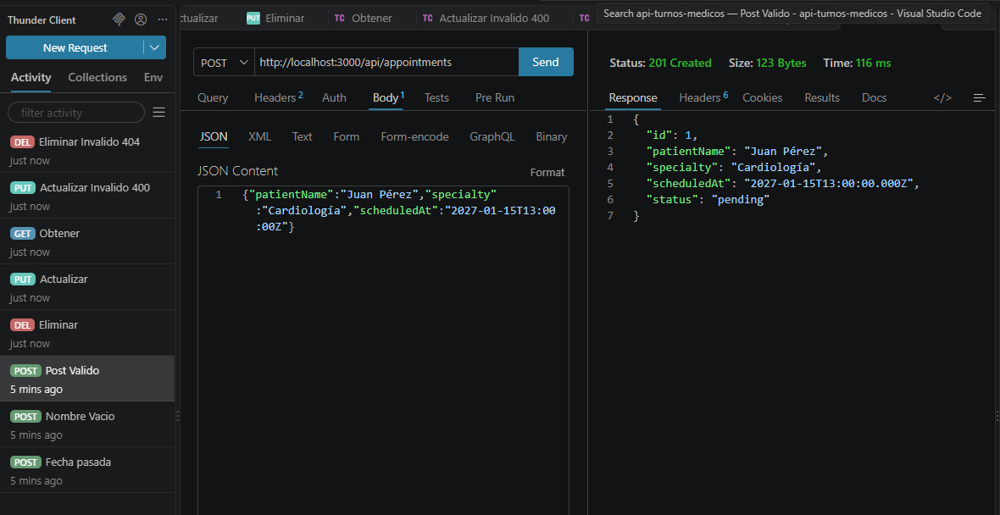
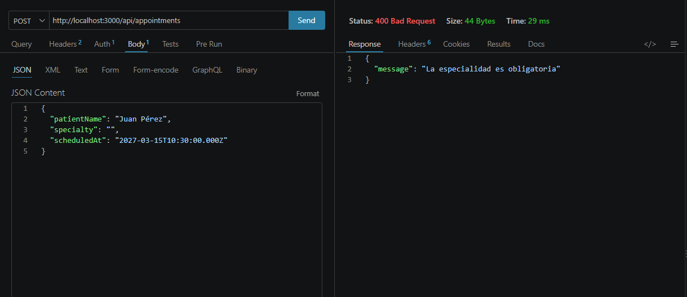
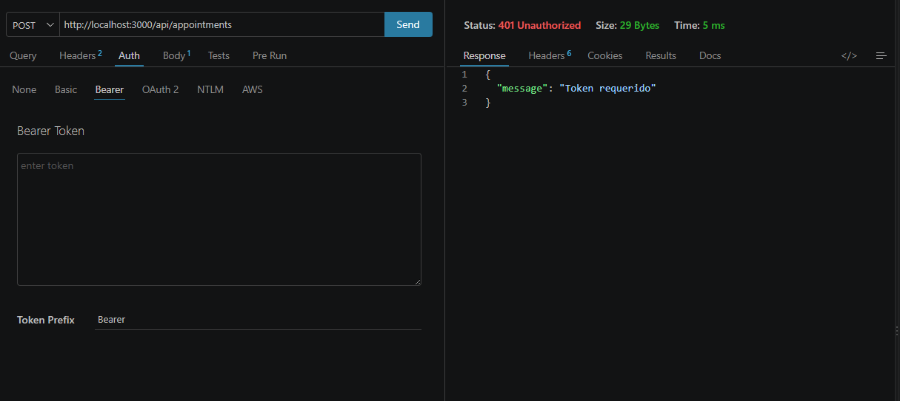
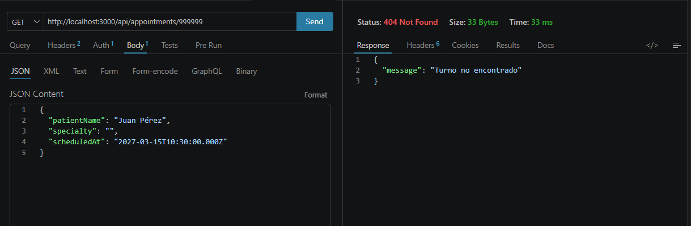

# API Turnos Médicos

API REST para gestionar turnos médicos, desarrollada como trabajo práctico integrador del Bootcamp 5.0 de Devlights.

Permite registrar usuarios, iniciar sesión con JWT y administrar turnos (crear, consultar, modificar y eliminar). La consulta de turnos es pública; crear, modificar y eliminar requieren un token válido.

## Tecnologías

- Node.js + TypeScript
- Express 5
- PostgreSQL 17 (Docker)
- Drizzle ORM y Drizzle Kit (migraciones)
- Bcrypt (hash de contraseñas)
- JSON Web Token (autenticación)

## Arquitectura

El proyecto está organizado por capas:

```
Routes → Controllers → Services → Repositories → PostgreSQL
```

- **Routes:** definen los endpoints y aplican el middleware de autenticación.
- **Controllers:** leen la request, validan el formato de los datos y eligen el código HTTP.
- **Services:** contienen las reglas de negocio (fechas futuras, campos obligatorios, hash, JWT).
- **Repositories:** acceden a la base de datos con Drizzle.

```
├── drizzle/                     # Migraciones SQL generadas por Drizzle Kit
├── images/                      # Evidencias de pruebas
├── src/
│   ├── app.ts                   # Configuración de Express y rutas
│   ├── server.ts                # Punto de entrada
│   ├── auth/                    # Registro y login
│   │   ├── auth.routes.ts
│   │   ├── auth.controller.ts
│   │   ├── auth.service.ts
│   │   └── auth.repository.ts
│   ├── db/
│   │   ├── index.ts             # Conexión a PostgreSQL
│   │   └── schema.ts            # Tablas users y appointments
│   ├── middlewares/
│   │   └── auth.middleware.ts   # requireAuth: valida el Bearer Token
│   └── modules/appointments/    # CRUD de turnos
│       ├── appointment.routes.ts
│       ├── appointment.controller.ts
│       ├── appointment.service.ts
│       └── appointment.repository.ts
├── drizzle.config.ts
├── .env.example
└── package.json
```

## Requisitos previos

- Node.js 22 o superior
- npm
- Docker

## Instalación y ejecución

### 1. Instalar dependencias

```bash
npm ci
```

### 2. Configurar variables de entorno

Copiar el archivo de ejemplo y completar los valores:

```bash
cp .env.example .env
```

En PowerShell: `Copy-Item .env.example .env`. Los valores de ejemplo ya funcionan con el contenedor del paso 3.

| Variable | Descripción |
|---|---|
| `PORT` | Puerto de la API (por defecto `3000`) |
| `DATABASE_URL` | Cadena de conexión a PostgreSQL |
| `JWT_SECRET` | Secreto para firmar los tokens. Usar un valor largo y aleatorio |

### 3. Iniciar PostgreSQL con Docker

```bash
docker run -d --name tp-turnos-postgres \
  -e POSTGRES_USER=postgres \
  -e POSTGRES_PASSWORD=postgres \
  -e POSTGRES_DB=turnos_medicos \
  -p 5432:5432 \
  -v tp-turnos-pgdata:/var/lib/postgresql/data \
  postgres:17
```

Los valores de usuario, contraseña y base deben coincidir con `DATABASE_URL`. Si el contenedor ya existe, alcanza con iniciarlo:

```bash
docker start tp-turnos-postgres
```

### 4. Aplicar migraciones

```bash
npm run db:migrate
```

Crea las tablas `users` y `appointments` a partir de los archivos de `drizzle/`. Si se modifica `src/db/schema.ts`, generar una nueva migración con `npm run db:generate`.

### 5. Ejecutar

```bash
npm run dev
```

La API queda disponible en `http://localhost:3000`.

Otros scripts:

| Comando | Descripción |
|---|---|
| `npm run typecheck` | Verifica tipos sin compilar |
| `npm run build` | Compila TypeScript en `dist/` |
| `npm start` | Ejecuta la versión compilada |

## Endpoints

| Método | Ruta | Descripción | Bearer Token |
|---|---|---|---|
| GET | `/health` | Estado de la API | No |
| POST | `/api/auth/register` | Registrar usuario | No |
| POST | `/api/auth/login` | Iniciar sesión y obtener token | No |
| GET | `/api/appointments` | Listar turnos | No |
| GET | `/api/appointments/:id` | Obtener un turno | No |
| POST | `/api/appointments` | Crear turno | **Sí** |
| PUT | `/api/appointments/:id` | Modificar turno (campos parciales) | **Sí** |
| DELETE | `/api/appointments/:id` | Eliminar turno | **Sí** |

Las rutas protegidas requieren el header:

```
Authorization: Bearer <token>
```

El token se obtiene en el login y vence en **1 hora**.

## Ejemplos

### Registro — `POST /api/auth/register`

```json
{
  "email": "usuario@example.com",
  "password": "Password123"
}
```

Respuesta `201`:

```json
{
  "id": 1,
  "email": "usuario@example.com"
}
```

El email se guarda en minúsculas y sin espacios. La contraseña debe tener al menos 8 caracteres y se almacena hasheada con Bcrypt; nunca se devuelve en las respuestas.

### Login — `POST /api/auth/login`

```json
{
  "email": "usuario@example.com",
  "password": "Password123"
}
```

Respuesta `200`:

```json
{
  "token": "eyJhbGciOiJIUzI1NiIsInR5cCI6IkpXVCJ9...",
  "user": {
    "id": 1,
    "email": "usuario@example.com"
  }
}
```

### Crear turno — `POST /api/appointments` (requiere token)

```json
{
  "patientName": "Juan Pérez",
  "specialty": "Cardiología",
  "scheduledAt": "2027-03-15T10:30:00.000Z",
  "status": "pending"
}
```

Respuesta `201`:

```json
{
  "id": 1,
  "patientName": "Juan Pérez",
  "specialty": "Cardiología",
  "scheduledAt": "2027-03-15T10:30:00.000Z",
  "status": "pending"
}
```

Reglas de validación:

- `patientName` y `specialty` son obligatorios, no pueden estar vacíos y tienen un máximo de 120 caracteres.
- `scheduledAt` debe ser una fecha válida y futura.
- `status` es opcional: `pending` (por defecto), `confirmed` o `cancelled`.

### Modificar turno — `PUT /api/appointments/:id` (requiere token)

Se envían solo los campos a modificar:

```json
{
  "status": "confirmed"
}
```

## Códigos de respuesta

| Código | Significado |
|---|---|
| 200 | Operación exitosa (consulta, login, modificación, eliminación) |
| 201 | Recurso creado (usuario o turno) |
| 400 | Datos inválidos: JSON mal formado, campos vacíos, fecha inválida o pasada, ID inválido, estado desconocido |
| 401 | Token ausente, inválido o expirado; credenciales incorrectas |
| 404 | Turno no encontrado |
| 409 | El email ya está registrado |
| 500 | Error interno del servidor |

Los errores se devuelven con el formato:

```json
{
  "message": "Descripción del error"
}
```

## Evidencias de pruebas

### Semana 1 — CRUD de turnos



#### Error 400 — Datos inválidos

Se intenta crear un turno con una especialidad vacía. El Service rechaza la operación y la API responde `400 Bad Request`.



#### Error 401 — Acceso no autorizado

Se intenta crear un turno sin enviar el Bearer Token. El middleware `requireAuth` bloquea la solicitud y responde `401 Unauthorized`.



#### Error 404 — Recurso inexistente

Se consulta un turno cuyo ID no existe en PostgreSQL. La API responde `404 Not Found`.


### Entrega final — Autenticación y validaciones

Pruebas HTTP de integración ejecutadas contra la API con PostgreSQL:

| Operación | Esperado | Resultado |
|---|---|---|
| Registrar usuario | 201 | ✅ 201 |
| Email duplicado | 409 | ✅ 409 |
| Registros simultáneos con el mismo email | un 201, resto 409 | ✅ |
| Email o contraseña inválidos en registro | 400 | ✅ 400 |
| Login correcto | 200 | ✅ 200 |
| Credenciales incorrectas | 401 | ✅ 401 |
| JSON mal formado | 400 | ✅ 400 |
| Crear turno sin token | 401 | ✅ 401 |
| Token inválido, expirado o con otra firma | 401 | ✅ 401 |
| Crear turno con JWT | 201 | ✅ 201 |
| Especialidad o paciente vacíos | 400 | ✅ 400 |
| Fecha inválida o pasada | 400 | ✅ 400 |
| Estado desconocido | 400 | ✅ 400 |
| ID inválido | 400 | ✅ 400 |
| Consultar turnos sin JWT | 200 | ✅ 200 |
| Turno inexistente (GET, PUT, DELETE) | 404 | ✅ 404 |
| Modificar turno con JWT | 200 | ✅ 200 |
| Eliminar turno con JWT | 200 | ✅ 200 |

Ninguna respuesta incluye el hash de la contraseña.
