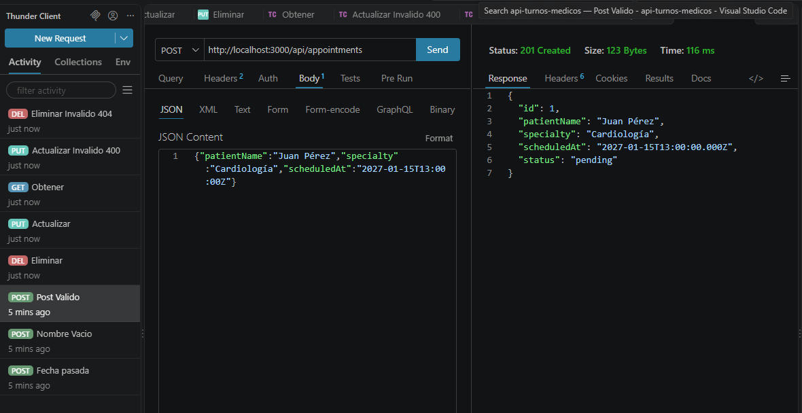

# API-TURNOS-MEDICO

Esta es una aplicación para practicar y validar mis habilidades en la creacion de APIs REST.

# Avances — Semana 1

- CRUD completo de turnos médicos.

- Persistencia en PostgreSQL y migraciones con Drizzle.

- Arquitectura por capas: Routes, Controllers, Services y Repositories.

- Validaciones de fechas, campos obligatorios y códigos de respuesta HTTP.

